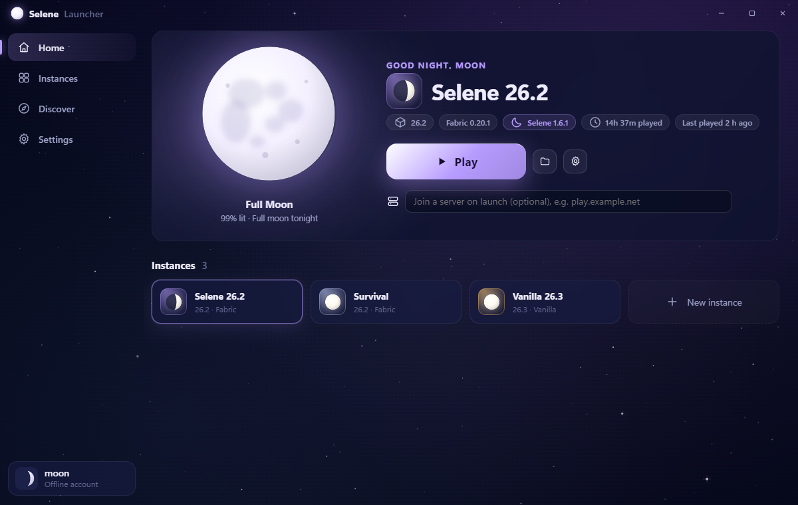
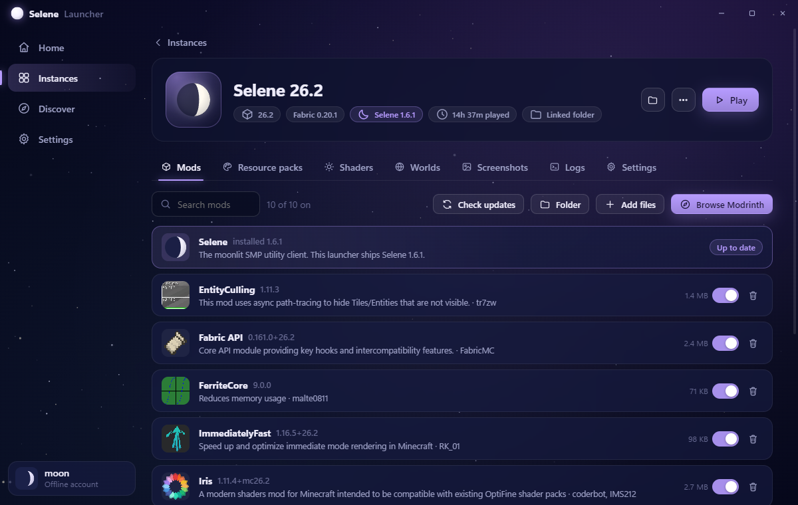
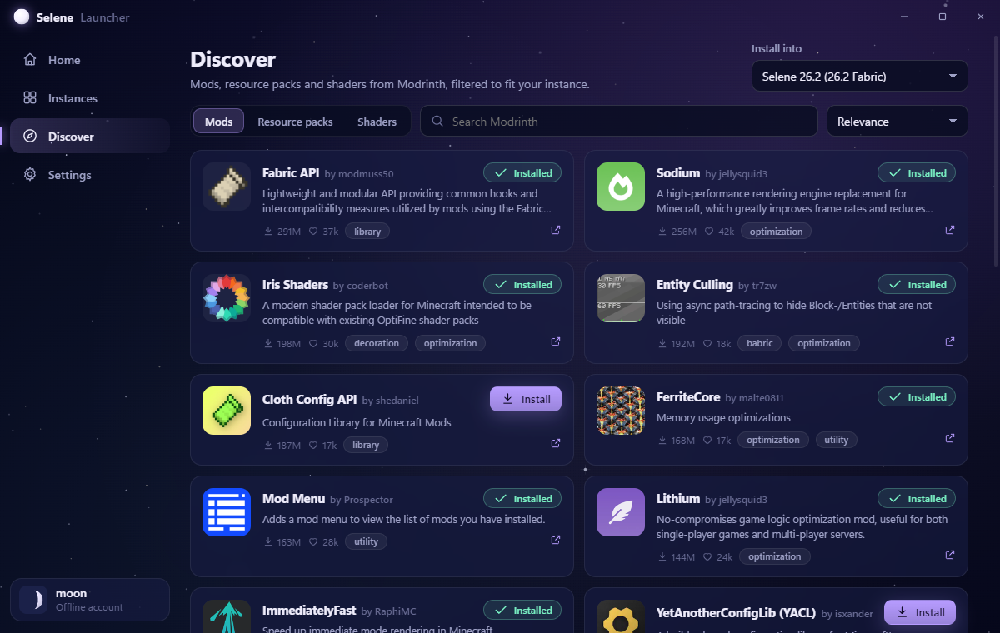
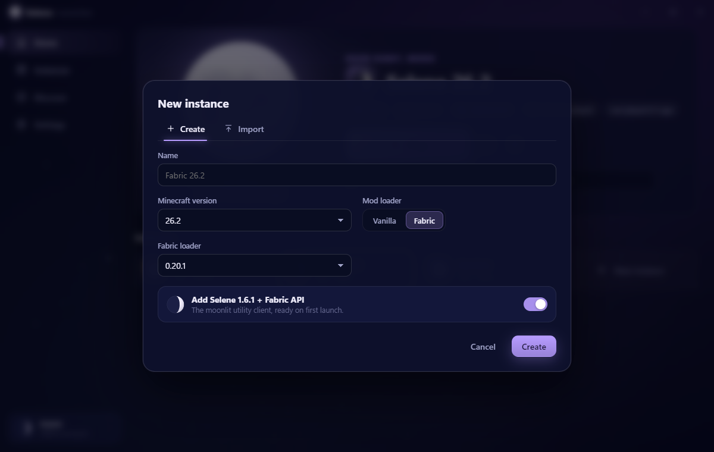
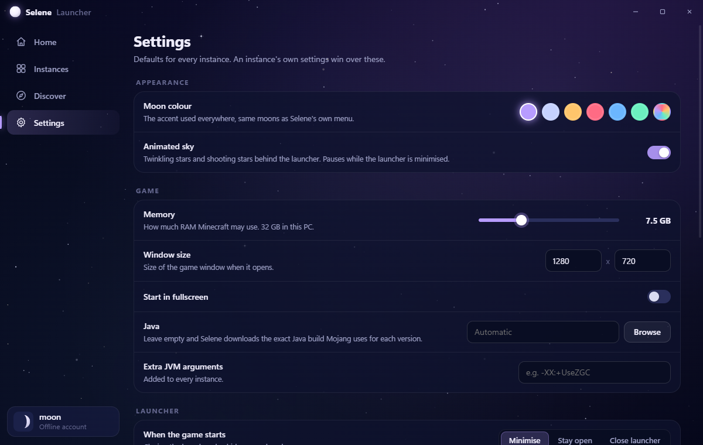

  

<h1 align="center">Selene Launcher</h1>

  A moonlit Minecraft: Java Edition launcher for Windows, made for the Selene client. 
  Made by <b>moon</b>.

  

## What it is

Selene Launcher is a small, non-commercial launcher I made for myself and a few friends. It installs and starts the official game by itself, with optional Fabric mods, and comes with the [Selene](#selene) client mod ready to go. There are no ads and no accounts of its own, and nothing is sent anywhere except to Microsoft, Mojang, Fabric and Modrinth.

## Features

- **Instances.** Each one has its own mods, resource packs, shaders, worlds, screenshots and settings. Create one for any release or snapshot, Vanilla or Fabric, import a Modrinth modpack (`.mrpack`), or use an existing game folder in place.
- **One-click Selene.** Sets up Fabric 26.2 with the Selene client and Fabric API, and tells you when Selene has an update.
- **Discover.** Search Modrinth for mods, resource packs and shaders, filtered to fit the instance. Required dependencies install automatically.
- **Manage mods.** Names, versions and icons straight from the jars, on/off switches, update checks, drag and drop, and removal to the Recycle Bin.
- **Just press Play.** Downloads Mojang's own Java build for each version (Java 25 for 26.x). Every file is checked against Mojang's checksums, and **Repair** re-checks everything.
- **Quick join.** Open a world or join a server straight from the launcher.
- **Live logs**, play-time tracking, and a dock showing which games are running.
- **Night-sky look.** Twinkling stars, shooting stars, tonight's real moon phase on the home screen, and six moon accent colours.

| Instance mods | Discover |
| --- | --- |
|  |  |
| **New instance** | **Settings** |
|  |  |

## Availability

Selene Launcher isn't publicly downloadable. I share it privately with a small group of friends, so there are no downloads on this page. This page is here to explain what the launcher does and how it handles sign-in.

It runs on Windows 10 and 11 (64-bit), and Java is downloaded automatically.

## Signing in and privacy

- **Microsoft accounts.** Sign-in uses Microsoft's official flow in Microsoft's own sign-in window: authorization code with PKCE, as a public client with no client secret, personal Microsoft accounts only. After that come the Xbox Live and XSTS tokens, then Minecraft's `login_with_xbox`, and the Minecraft profile (name and UUID) is read. The game only launches for accounts that own Java Edition.
- **Your data stays on your PC.** Sign-in tokens are stored locally and encrypted with Windows DPAPI. The launcher has no servers, collects nothing, and never changes account details, names or skins.
- **Offline accounts** work for singleplayer, LAN and offline-mode servers.
- **Who the launcher talks to:**
  - Microsoft sign-in, Xbox Live, `api.minecraftservices.com`
  - Mojang's game files: `piston-meta.mojang.com`, `piston-data.mojang.com`, `libraries.minecraft.net`, `resources.download.minecraft.net`
  - Fabric: `meta.fabricmc.net`, `maven.fabricmc.net`
  - Modrinth: `api.modrinth.com`, `cdn.modrinth.com`

## Selene

Selene is the moon-themed SMP utility client the launcher ships with. It's a Fabric mod for Minecraft 26.2 with a draggable HUD, zoom, freelook, a clear hotbar, micro durability, a hunger overlay, kits and much more. Open it in game with **Right Shift**.

## Notes

NOT AN OFFICIAL MINECRAFT PRODUCT. NOT APPROVED BY OR ASSOCIATED WITH MOJANG OR MICROSOFT.

Minecraft is a trademark of Mojang AB. Mods found through Discover belong to their authors and are downloaded from Modrinth.
